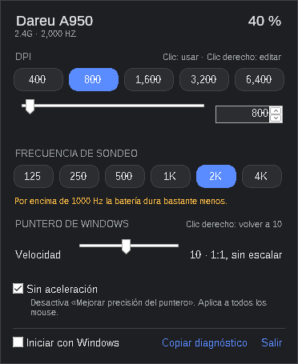

# Dareu Mouse para Windows

App de bandeja del sistema para el **Dareu A950 PRO 4K** con su receptor 2.4G.
Es la versión para Windows del plugin `corico.mouse` de Omarchy.



## Qué hace

- **DPI:** muestra los 5 niveles del mouse. Haz clic en uno para usarlo, o clic
  derecho para editar su valor sin cambiar el nivel activo. Se ajusta con la
  barra o con la casilla numérica, en pasos de 50, de 100 a 26 000.
- **Frecuencia de sondeo:** de 125 a 4000 Hz con el receptor, y hasta 1000 Hz
  por cable. Por encima de 1000 Hz te avisa que la batería dura bastante menos.
- **Batería:** porcentaje y si está cargando. El ícono de la bandeja se llena
  según la carga y avisa con una notificación al bajar del 15 %.
- **Velocidad del puntero y aceleración:** usan los ajustes del propio Windows
  (los mismos de Configuración → Mouse). 10 es 1:1, sin escalar. "Sin
  aceleración" desactiva "Mejorar precisión del puntero". Aplican a todos los
  mouse.
- **Iniciar con Windows:** opcional y sin permisos de administrador.

Cada cambio en el mouse se vuelve a leer para confirmarlo. La app no envía
comandos de firmware, de reinicio, de emparejamiento ni de macros.

## Instalar

1. Descarga `DareuMouse.exe` y guárdalo donde quieras, por ejemplo en
   `C:\Users\<tú>\Apps\`.
2. Ábrelo. No necesita instalación, drivers ni .NET.
3. Si Windows SmartScreen avisa ("Windows protegió su PC"), elige
   **Más información → Ejecutar de todas formas**. El aviso sale porque el exe
   no está firmado.
4. El panel se abre junto a la bandeja. Ciérralo con Esc o haciendo clic
   fuera; vuelve a abrirlo con el ícono del mouse. Si no ves el ícono, está en
   la flecha **^** de la bandeja; puedes arrastrarlo a la barra de tareas.

Si el mouse está dormido, la app lo dice. Muévelo y espera unos segundos.

### Modo demo

`DareuMouse.exe --demo` abre el panel con un mouse simulado, sin tocar el
hardware.

## Compatibilidad

Solo reconoce estos dispositivos, con la interfaz de comandos `FF02:0002`:

| Dispositivo | VID:PID |
| --- | --- |
| Receptor 2.4G (TM265) | `260D:1114` |
| Mouse por cable | `260D:1117` |

Con el cable conectado, usa primero la conexión por cable. Si el mouse no
responde por cable, usa el receptor.

## Si algo falla

En el panel, **Copiar diagnóstico** copia al portapapeles el estado y la lista
de dispositivos HID. Pégalo en un issue o en el chat.

## Compilar

Necesitas el SDK de .NET 10. Se puede compilar desde Windows o desde Linux.

```bash
dotnet test
dotnet publish src/DareuMouse -c Release -o dist
```

- `src/DareuMouse.Core`: el protocolo y la lógica del mouse. No depende de
  Windows y lo cubren las pruebas.
- `src/DareuMouse`: la app WinForms, el acceso HID con SetupAPI y `hid.dll`,
  y los ajustes del puntero.
- `tests/DareuMouse.Tests`: pruebas con un A950 simulado.

## Créditos

El formato del protocolo sigue la documentación del proyecto
[OpenMouse](https://github.com/OpenMouse-Project/mouse-protocol) para el
A950 PRO Mg. Este código es una implementación independiente.
