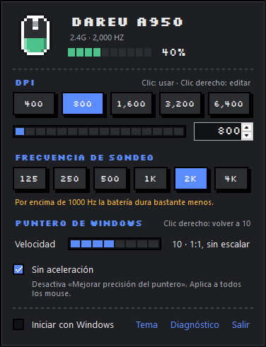
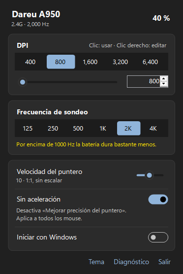
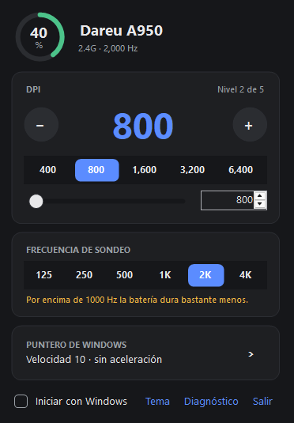
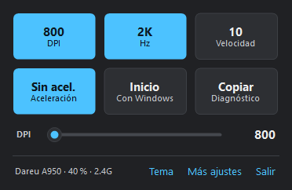
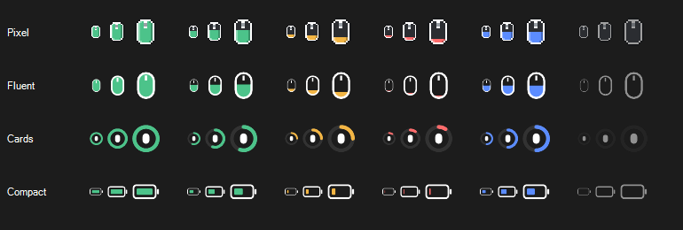

# Dareu Mouse para Windows

App de bandeja del sistema para el **Dareu A950 PRO 4K** con su receptor 2.4G.
Es la versión para Windows del plugin `corico.mouse` de Omarchy.



## Qué hace

- **DPI:** muestra los 5 niveles del mouse. Haz clic en uno para usarlo, o clic
  derecho para editar su valor sin cambiar el nivel activo. Se ajusta con la
  barra o con la casilla numérica, en pasos de 50, de 100 a 26 000.
- **Frecuencia de sondeo:** de 125 a 4000 Hz con el receptor, y hasta 1000 Hz
  por cable. Por encima de 1000 Hz te avisa que la batería dura bastante menos.
- **Batería:** porcentaje y si está cargando. El ícono de la bandeja se llena
  según la carga y avisa con una notificación al bajar del 15 %.
- **Velocidad del puntero y aceleración:** usan los ajustes del propio Windows
  (los mismos de Configuración → Mouse). 10 es 1:1, sin escalar. "Sin
  aceleración" desactiva "Mejorar precisión del puntero". Aplican a todos los
  mouse.
- **Iniciar con Windows:** opcional y sin permisos de administrador.
- **Temas:** cuatro aspectos para el panel y el ícono de la bandeja (abajo).

Cada cambio en el mouse se vuelve a leer para confirmarlo. La app no envía
comandos de firmware, de reinicio, de emparejamiento ni de macros.

## Temas

Elige el tema con clic derecho en el ícono de la bandeja → **Tema**, o con el
enlace **Tema** del panel. La app lo recuerda. El ícono de la bandeja cambia con
el tema; el del programa y el instalador es siempre el de pixel art.

| Pixel art (por defecto) | Windows 11 | Tarjetas | Compacto |
|---|---|---|---|
|  |  |  |  |

- **Pixel art:** el ratón del ícono en grande, la batería en bloques, botones
  cuadrados con sombra y barras de bloques. Títulos con la fuente
  [Silkscreen](https://github.com/googlefonts/silkscreen).
- **Windows 11:** tarjetas, controles segmentados e interruptores. Sigue el modo
  claro u oscuro y el color de acento de Windows.
- **Tarjetas:** anillo de batería y el DPI en grande; − y + cambian de nivel.
  "Puntero de Windows" se despliega al hacer clic.
- **Compacto:** mosaicos como la configuración rápida de Windows. DPI y Hz pasan
  al siguiente valor con cada clic (clic derecho en DPI: el anterior). **Más
  ajustes** abre todo lo demás.

Íconos de la bandeja por tema (100 %, 55 %, 25 %, 10 %, cargando y sin mouse):



## Instalar

1. Abre `DareuMouse-Setup-1.0.0.exe`. No pide permisos de administrador: se
   instala en `%LOCALAPPDATA%\Programs\Dareu Mouse`, con acceso en el menú
   Inicio y, si lo eliges, en el escritorio y al iniciar Windows.
2. Si Windows SmartScreen avisa ("Windows protegió su PC"), elige
   **Más información → Ejecutar de todas formas**. El aviso sale porque el
   instalador no está firmado.
3. Para desinstalar: Configuración → Aplicaciones → Dareu Mouse.

También puedes usar `DareuMouse.exe` solo, sin instalar: guárdalo en una carpeta
fija y ábrelo. No necesita drivers ni .NET.

El panel se abre junto a la bandeja. Ciérralo con Esc o haciendo clic fuera;
vuelve a abrirlo con el ícono del mouse. Si no ves el ícono, está en la flecha
**^** de la bandeja; puedes arrastrarlo a la barra de tareas.

Si el mouse está dormido, la app lo dice. Muévelo y espera unos segundos.

### Modo demo

`DareuMouse.exe --demo` abre el panel con un mouse simulado, sin tocar el
hardware.

## Compatibilidad

Solo reconoce estos dispositivos, con la interfaz de comandos `FF02:0002`:

| Dispositivo | VID:PID |
| --- | --- |
| Receptor 2.4G (TM265) | `260D:1114` |
| Mouse por cable | `260D:1117` |

Con el cable conectado, usa primero la conexión por cable. Si el mouse no
responde por cable, usa el receptor.

## Si algo falla

En el panel, **Copiar diagnóstico** copia al portapapeles el estado y la lista
de dispositivos HID. Pégalo en un issue o en el chat.

## Compilar

Necesitas el SDK de .NET 10. Se puede compilar desde Windows o desde Linux.

```bash
dotnet test
dotnet publish src/DareuMouse -c Release -o dist
makensis installer/DareuMouse.nsi
```

El instalador se arma con [NSIS](https://nsis.sourceforge.io/) y queda en
`dist/DareuMouse-Setup-<versión>.exe`.

- `src/DareuMouse.Core`: el protocolo y la lógica del mouse. No depende de
  Windows y lo cubren las pruebas.
- `src/DareuMouse`: la app WinForms, el acceso HID con SetupAPI y `hid.dll`,
  y los ajustes del puntero.
- `tests/DareuMouse.Tests`: pruebas con un A950 simulado.

## Créditos

El formato del protocolo sigue la documentación del proyecto
[OpenMouse](https://github.com/OpenMouse-Project/mouse-protocol) para el
A950 PRO Mg. Este código es una implementación independiente.

La fuente Silkscreen (Copyright 2001 The Silkscreen Project Authors) va dentro
de la app bajo la [SIL Open Font License 1.1](src/DareuMouse/Fonts/OFL.txt).

## Licencia

[MIT](LICENSE)
